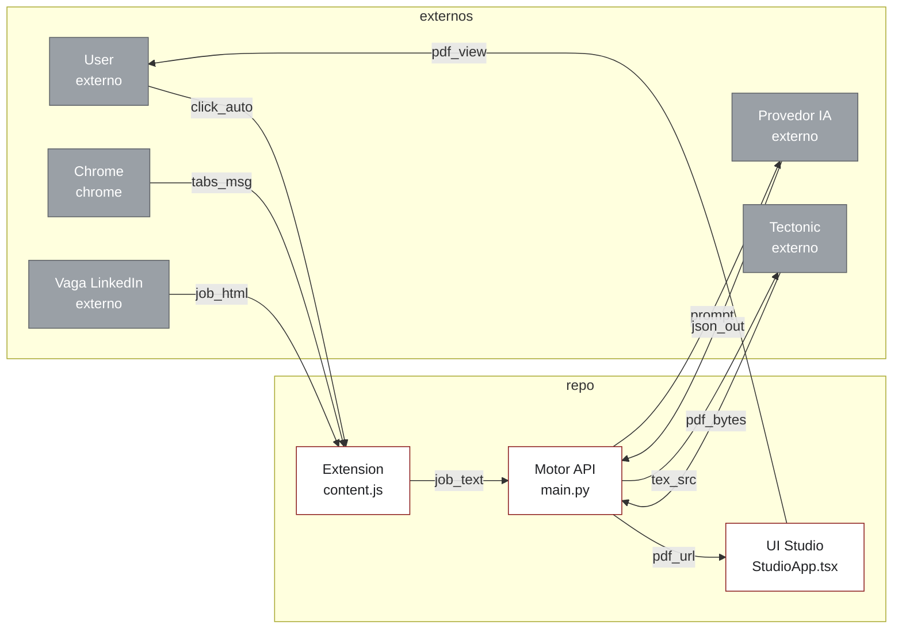
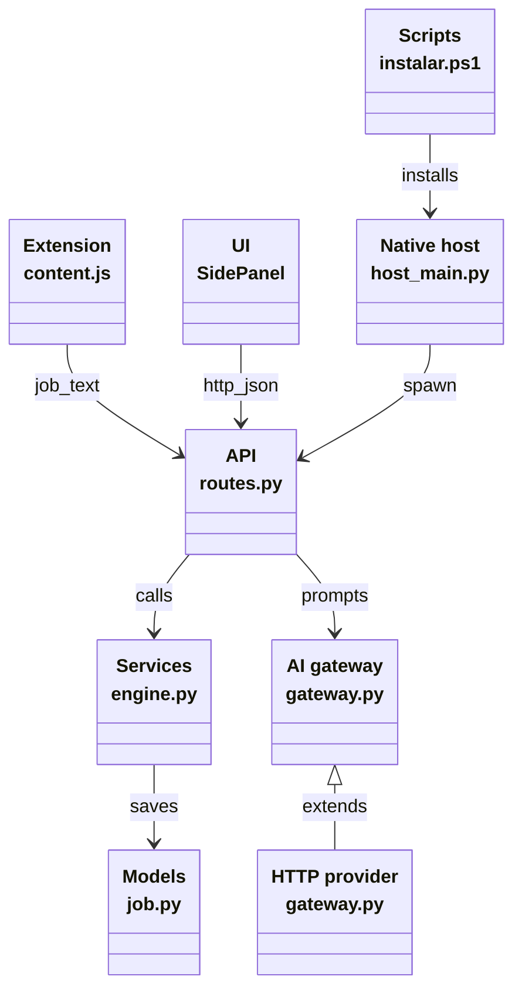

# Architecture

## Context

| edge | source | sink |
| ---- | ------ | ---- |
| `click_auto` | `ui/src/SidePanelApp.tsx:160` | `ui/src/chrome.ts:39` |
| `tabs_msg` | `ui/src/chrome.ts:45` | `extension/content.js:491` |
| `job_html` | `extension/content.js:61` | `extension/content.js:503` |
| `job_text` | `extension/content.js:503` | `backend/app/api/routes.py:363` |
| `prompt` | `backend/app/services/ai/gateway.py:336` | provider HTTPS API |
| `json_out` | provider HTTPS API | `backend/app/services/ai/vision.py:122` |
| `tex_src` | `backend/app/services/latex/engine.py:311` | tectonic subprocess |
| `pdf_bytes` | tectonic subprocess | `backend/app/services/latex/engine.py:245` |
| `pdf_url` | `backend/app/api/routes.py:474` | `ui/src/components/studio/StudioWorkspace.tsx:128` |
| `pdf_view` | `ui/src/components/studio/StudioWorkspace.tsx:128` | user download |

Notes: the user drives the extension, the repo calls providers and Tectonic, Chrome carries tab messages. No screenshot crosses the boundary, per `docs/adr/001-captura-dom.md`.

## Containers

| edge | source | sink |
| ---- | ------ | ---- |
| `job_text` | `extension/content.js:503` | `backend/app/api/routes.py:363` |
| `http_json` | `ui/src/services/api.ts:239` | `backend/app/api/routes.py:363` |
| `calls` | `backend/app/api/routes.py:372` | `backend/app/services/latex/engine.py:311` |
| `saves` | `backend/app/api/routes.py:322` | `backend/app/models/job.py:42` |
| `spawn` | `native-host/host_main.py:175` | `backend/run.py:1` |
| `installs` | `scripts/instalar.ps1:1` | `native-host/install-host.ps1:1` |
| `prompts` | `backend/app/api/routes.py:265` | `backend/app/services/ai/gateway.py:336` |
| `extends` | `backend/app/services/ai/gateway.py:336` | provider subclass in same file |

Notes: module boundaries match folders. The UI never touches SQLite or LaTeX directly. Everything crosses `routes.py`.
