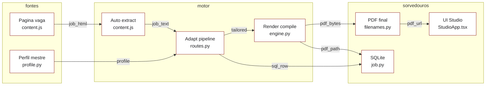
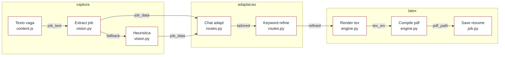

# Data movement

## L0

| edge | source | sink |
| ---- | ------ | ---- |
| `job_html: dom text` | `extension/content.js:61` | `extension/content.js:407` |
| `job_text: string ≤30000` | `extension/content.js:407` | `backend/app/api/routes.py:377` |
| `profile: CandidateProfile` | `backend/app/models/profile.py:27` | `backend/app/api/routes.py:307` |
| `tailored: dict` | `backend/app/api/routes.py:307` | `backend/app/services/latex/engine.py:318` |
| `pdf_bytes: bytes` | `backend/app/services/latex/engine.py:246` | `backend/app/services/latex/filenames.py:47` |
| `pdf_path: string` | `backend/app/services/latex/engine.py:318` | `backend/app/models/job.py:42` |
| `sql_row: job plus resume` | `backend/app/api/routes.py:325` | `backend/app/models/job.py:42` |
| `pdf_url: string` | `backend/app/api/routes.py:490` | `ui/src/components/studio/StudioWorkspace.tsx:128` |

Read left to right, sources to sinks. Retries fold into one edge each.

## L1 detail: adapt pipeline

| step | code | data |
| ---- | ---- | ---- |
| 1 | `backend/app/api/routes.py:386` | `job_text` enters `extract_job_from_text` |
| 2 | `backend/app/services/ai/vision.py:119` | AI failure falls back to `heuristic_extract` |
| 3 | `backend/app/services/ai/vision.py:122` | thin AI result fills gaps from heuristic |
| 4 | `backend/app/api/routes.py:307` | pass 1 chat returns adapted JSON |
| 5 | `backend/app/api/routes.py:279` | pass 2 refines missing ATS keywords |
| 6 | `backend/app/services/latex/engine.py:318` | `render_tex` builds the tex source |
| 7 | `backend/app/services/latex/engine.py:246` | `compile_pdf` runs Tectonic or pdflatex |
| 8 | `backend/app/models/job.py:42` | `save_adapted_resume` persists tex plus pdf path |
